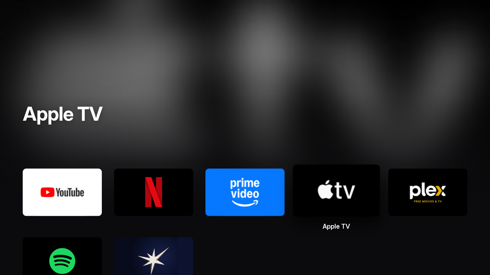
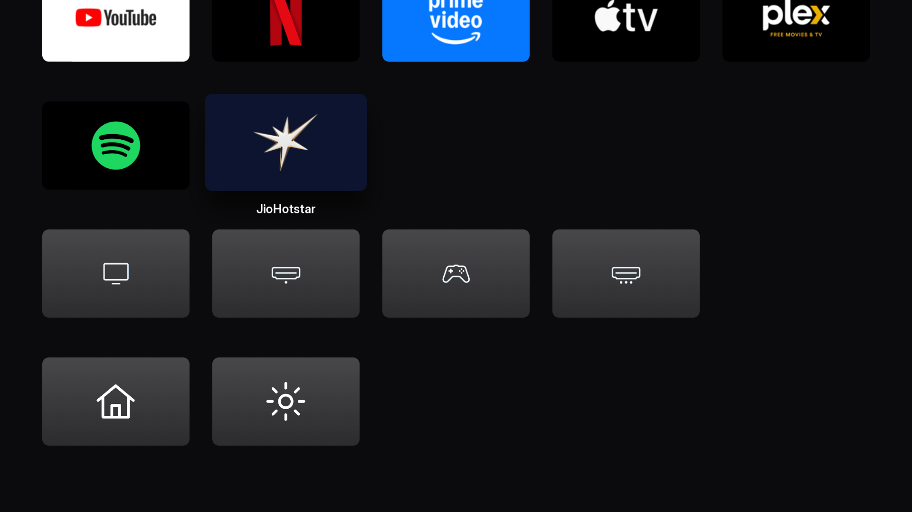

# webOS Launcher, Apple TV edition

An Apple TV–style home screen for LG webOS TVs. It's a fork of
[partridgeworks/webos-launcher](https://github.com/partridgeworks/webos-launcher),
restyled after tvOS and tuned to run at 60fps on the TV.



- **Top shelf**: the focused app's artwork fills the top of the screen, blurred, with its
  name in large type
- **tvOS grid**: wide rounded icons, five to a line. The focused icon lifts with a shadow
  and a sweep of light, and only it shows its name
- **Apps, then sources, then More**: your apps in your order, Live TV and the HDMI inputs,
  LG's own home and Settings
- **Smooth on TV hardware**: everything that moves is transform or opacity, the top-shelf
  blur is baked once per app, and a focus move re-renders only two tiles
- Inter Display type, the closest open match to Apple's SF Pro
- No root, no background service, no startup scripts: a plain app in its own sandbox



> This fork is a personal project shared as-is. The original's design and most of the
> plumbing (catalogue, inputs, Settings, packaging) are by its authors.

## Using it

| Where | Key | Does |
|---|---|---|
| Home | ↑ ↓ | Move between lines (moving below the first slides the grid over the top shelf) |
| Home | ← → | Move along a line |
| Home | OK | Open the app or input |
| Settings | OK | Add or remove an app/source |
| Settings | Hold OK (or **Re-order** button) | Enter/leave re-order mode |
| Re-order mode | OK, arrows, OK | Pick up a tile, move it, put it down |
| Re-order mode | Back | Cancel the move / leave re-order mode |
| Settings | Back | Return home |

The Magic Remote pointer is hidden when the launcher opens; shake the remote to bring it
back. Clicking works everywhere.

The launcher doesn't take over the HOME button. On a rooted TV you can map a button to it
with [LG Input Hook](https://github.com/Simon34545/lginputhook) (app ID
`works.partridge.webos-launcher`).

## Install

**From the Homebrew Channel** (rooted TVs): search for *Launcher*.

**From a release**: download the `.ipk` from
[Releases](../../releases) and install it with the Homebrew Channel, the
[webOS CLI](https://webostv.developer.lge.com/develop/tools/cli-installation)
(`ares-install`), or [webOS Dev Manager](https://github.com/webosbrew/dev-manager-desktop).
It also works in LG's Developer Mode, without root.

## Build

Needs Node 18+.

```sh
npm install
npm run build      # type-check, then build dist/ (chrome79, classic script)
npm run package    # dist/ → build/works.partridge.webos-launcher_<version>_all.ipk
```

To install on a rooted TV over SSH, copy `tv.env.example` to `tv.env` (git-ignored) and
set `TV_HOST` to an ssh alias or `root@<tv-ip>`, then:

```sh
npm run install:tv   # copy the ipk over SSH, install it, launch it
npm run deploy       # build + package + install:tv
```

`npm run dev` serves the UI in a desktop browser with sample inputs and the whole
catalogue, for layout work without a TV.

## Which apps appear

webOS 6 doesn't let a sideloaded web app list the installed apps or read their icons.
So the launcher ships a catalogue ([src/config/catalog.ts](src/config/catalog.ts)) with
icon copies in [public/icons/apps/](public/icons/apps/), and shows only the entries the TV
reports as installed (`applicationManager/getAppLoadStatus`, which is allowed). Apps
without a bundled icon get a tile with their name. Square icons sit in the middle of the
wide tile, and the sides are filled with the icon's own edge colours, sampled once with a
canvas.

To add your own apps or change the default row **without editing tracked files**, copy
[src/config/catalog.local.example.ts](src/config/catalog.local.example.ts) to
`src/config/catalog.local.ts` (git-ignored) and rebuild.

### Option: live app list via the Homebrew Channel (off by default)

*Settings → Options → Live app list via Homebrew Channel.*

On a rooted TV with the [Homebrew Channel](https://github.com/webosbrew/webos-homebrew-channel),
turning this on reads the full list of installed apps and their real icons, instead of
the catalogue. It works by asking the Homebrew Channel's service to run
`luna-send ... listLaunchPoints` and to base64-encode each icon file. **Those commands run
as root.** The launcher only sends fixed commands; icon paths are validated and
shell-quoted before use, and app IDs never reach the shell. If the Homebrew Channel isn't
there, the launcher says so and uses the catalogue. Icons are cached in the app's local
storage.

## Compatibility and testing

The original was tested on an LG OLED C1 (2021) running **webOS 6.5**, rooted, with the
Homebrew Channel 0.7.3. This fork's redesign was tested on an unrooted LG 65" TV in
Developer Mode (Chromium 120). Everything else is untested:

- Newer webOS (22 and later) should run it, since the build targets an older engine, but
  the Luna calls it relies on haven't been confirmed there.
- Older webOS (5 and earlier) is unknown; the External Input Manager call
  (`com.webos.service.eim/getAllInputStatus`) may differ.
- Only the UK app IDs in the catalogue were checked on a real TV. The others come from
  public sources and are simply skipped if wrong.

Reports of what works on other models are welcome as issues, though see *no maintainer*
above.

### Notes for developers

- **Chrome 79.** `<script type="module">` won't load from `file://` on webOS 6 (no MIME
  type), and `?.`/`??` are syntax errors. [vite.config.ts](vite.config.ts) builds one IIFE
  for `chrome79` and rewrites the script tag; CI fails the build if ES2020 syntax slips
  in. The CSS avoids flex `gap`, `inset` and `aspect-ratio`.
- **Luna calls used** (all in the "public" LS2 group a web app gets):
  `applicationManager/launch`, `applicationManager/getAppLoadStatus`,
  `eim/getAllInputStatus`. Denied to web
  apps on webOS 6: `listLaunchPoints`, `listApps`, `getAppInfo`, `getForegroundAppInfo`.
- **Pointer.** The pointer is drawn by the system, so CSS `cursor: none` does nothing;
  the app calls `webOSSystem.setCursorHidden(true)` when it comes to the foreground.
- **Remote debugging.** A dev-mode or rooted TV exposes the web inspector on port 9998.

## Project layout

```
src/
  config/      constants (IDs, key codes, Luna URIs) and the app catalogue
  theme/       design tokens (colours, type, layout, motion) and the stylesheet
  lib/         Luna bridge, launching, inputs, app providers, storage, pointer,
               icon edge colours, baked top-shelf backdrops
  hooks/       remote keys, OK press/hold
  components/  Grid, Tile, OptionList, Glyph, Toast
  screens/     Home, Settings
  app.tsx      state, data loading and wiring
scripts/       package.sh, install.sh, gen-manifest.mjs
public/        appinfo.json, app icon, bundled icons, licence texts
.github/       build on push; release (ipk + Homebrew manifest) on tag
```

## Releasing

Bump `version` in `public/appinfo.json` (and `package.json`), commit, then push a
matching tag:

```sh
git tag v1.0.1 && git push origin v1.0.1
```

The release workflow builds the ipk, generates the Homebrew Channel manifest
(`works.partridge.webos-launcher.manifest.json`, with the ipk's SHA-256) and attaches both
to a GitHub release. The Homebrew repository reads the manifest from the latest release.

## Licence and credits

Code: [MIT](LICENSE). Bundled Preact (MIT) and the Inter typeface (SIL OFL 1.1): see
[THIRD_PARTY_NOTICES.md](THIRD_PARTY_NOTICES.md).

**Third-party icons.** The app and input icons in `public/icons/` belong to their owners
and are not covered by the MIT licence. They're included in good faith, only to show
recognisable tiles for apps already on the user's TV. Rights holders can ask for removal
by opening an issue; see [THIRD_PARTY_NOTICES.md](THIRD_PARTY_NOTICES.md). This project is
not affiliated with LG Electronics or any app publisher.

Written with AI assistance (Claude Code), directed, tested and reviewed by a human on a
real TV. The Apple TV redesign likewise. Apple TV and tvOS are trademarks of Apple Inc.;
this project isn't affiliated with Apple.
